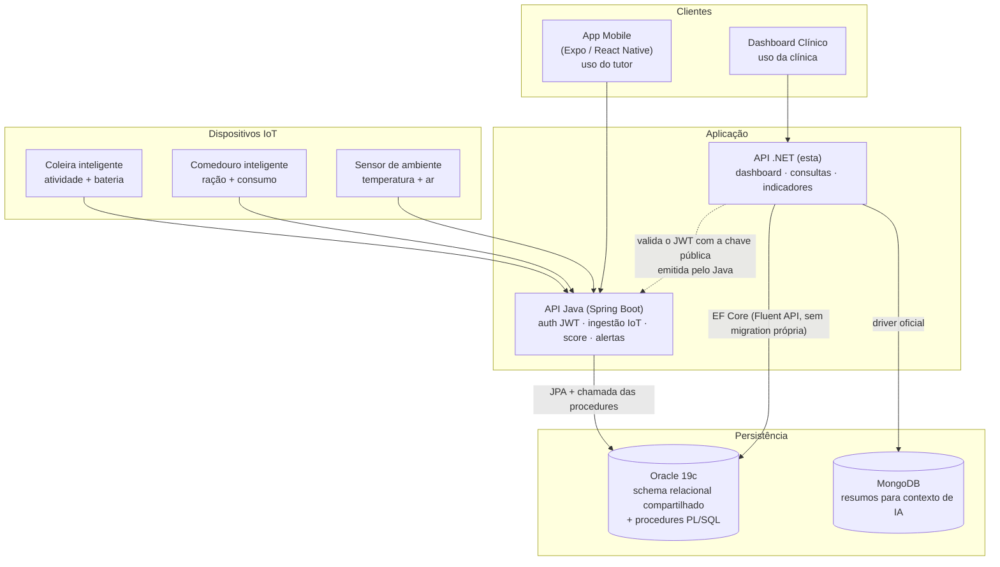

# PetCare Hub — API .NET Dashboard Clínico

API RESTful desenvolvida em **.NET 9** para a disciplina **Advanced Business Development with .NET**, dentro do Challenge FIAP 2026 — CLYVO VET.

A API representa o **dashboard B2B da clínica veterinária**, permitindo consultar informações clínicas, pets, alertas de saúde, consultas, scores e indicadores operacionais.

**No ar em:** https://petcarehub-dotnet.onrender.com — a raiz abre o Swagger. Hospedada em
container, com a mesma chave pública RSA da API Java, de onde vêm os tokens. Ver
[Deploy (Docker e Render)](#deploy-docker-e-render).

> O plano free dorme após ~15 min sem tráfego: o primeiro acesso pode levar ~50 s.

---

## Contexto do Projeto

O Challenge CLYVO VET propõe transformar a jornada de saúde animal de um modelo reativo e fragmentado para uma experiência contínua, preventiva, inteligente e integrada.

Dentro dessa solução, o **PetCare Hub** atua como uma plataforma de acompanhamento contínuo da saúde do pet.

A API .NET tem como foco o painel da clínica, permitindo que profissionais acompanhem:

- Pets vinculados à clínica;
- Pets em risco;
- Alertas de saúde abertos;
- Consultas realizadas;
- Scores de saúde;
- Eventos preventivos;
- Indicadores do dashboard clínico.

---

## Objetivo da API .NET

A API .NET é responsável por servir os dados do **dashboard da clínica veterinária**, consumindo o banco Oracle modelado na disciplina de Database.

A aplicação permite:

- Gerenciar clínicas via CRUD completo;
- Consultar pets vinculados à clínica (somente leitura);
- Gerenciar consultas via CRUD completo (com filtros por clínica, pet, tipo e retorno);
- Gerenciar alertas de saúde via CRUD completo (com filtros por pet, nível e situação);
- Resolver alertas;
- Consultar tutores dos pets;
- Consultar scores de saúde com filtros por categoria e faixa de score;
- Exibir métricas consolidadas no dashboard.

---

## Decisões de Arquitetura

Esta API é o **dashboard B2B** da clínica veterinária parceira. O ciclo de vida dos dados é dividido entre as APIs da plataforma PetCare Hub:

- **Pets, Tutores e Scores de Saúde** são expostos **apenas para leitura** nesta API. O cadastro, atualização e remoção desses recursos pertence à API Java (consumida pelo tutor através do app mobile), que é a fonte de verdade dos dados do animal e do seu tutor. Os Scores de Saúde são calculados pela API Java a partir das leituras IoT e gravados no banco Oracle compartilhado.
- **Consultas e Alertas de Saúde** possuem **CRUD completo** nesta API, pois representam operações realizadas pela equipe da clínica no seu dia a dia (registrar uma consulta, abrir ou resolver um alerta).
- **Clínicas** são lidas e atualizadas aqui, mas não criadas. Esta API não mapeia `SENHA_HASH` de propósito — autenticação é responsabilidade exclusiva da API Java —, então uma clínica criada aqui nasceria sem senha, e clínica sem senha pode ser reivindicada por quem souber o e-mail e o CNPJ, que é público. O credenciamento é `POST /auth/cadastro-clinica` na API Java, onde a própria clínica define a senha e um admin aprova. A exclusão existe aqui, restrita ao perfil ADMIN.

Essa separação garante que cada API tenha responsabilidade clara sobre o seu domínio e evita duplicação de regras de negócio entre Java e .NET.

---

## Autenticação

O .NET **nunca emite token** — quem faz login (e-mail/senha) é a API Java, via `POST /auth/login`.
O .NET só **valida** esse mesmo token: confere a assinatura RSA (RS256), o emissor
(`petcare-hub-api`), a validade e a claim `role`.

Todos os endpoints de dados (`Clinicas`, `Consultas`, `AlertasSaude`, `Pets`, `ScoresSaude`,
`Tutores`, `Dashboard`) exigem um `Authorization: Bearer <token>` com `role = CLINICA` — é
coerente com o resto do README: esta API é o dashboard B2B da clínica, não existe fluxo de
tutor aqui. Só `/health`, `/health/live` e `/health/ready` ficam públicos (é o que uma
ferramenta de monitoramento externa chama, sem credencial nenhuma).

| Situação | Resposta |
|---|---|
| Sem header `Authorization` | `401 Unauthorized` |
| Token malformado, assinatura inválida ou expirado | `401 Unauthorized` |
| Token válido, mas `role` diferente de `CLINICA` (ex.: `TUTOR`) | `403 Forbidden` |
| Token válido com `role = CLINICA` | segue normalmente |

### Como conseguir um token para testar

1. Suba a API Java localmente (ela cria a clínica de exemplo automaticamente em banco vazio —
   ver o `DataLoader` no README do Java) ou use as credenciais de uma clínica já cadastrada no
   Oracle compartilhado.
2. Chame `POST /auth/login` na API Java (Swagger em `/swagger-ui.html`) com o e-mail/senha da
   clínica.
3. Use o `token` da resposta como Bearer nas chamadas ao Swagger desta API .NET (botão
   **"Authorize"**).

### Configuração da chave pública

A assinatura é validada com a mesma chave RSA pública que o Java usa para assinar (nunca a
chave privada — o .NET só verifica, não emite). Por padrão, a API usa a chave de
desenvolvimento/teste commitada em `PetCareHub.API/Keys/public_key.pem` (a mesma usada pela
suíte de testes do lado Java). Em produção, sobrescreva com a chave pública real via variável
de ambiente:

```txt
Jwt__PublicKeyPem="-----BEGIN PUBLIC KEY-----
...
-----END PUBLIC KEY-----"
```

A variável aceita as mesmas duas formas que o `rsa.public-key` do Java: o conteúdo do PEM
direto, como acima, ou um caminho prefixado com `file:`.

```txt
Jwt__PublicKeyPem="file:/etc/secrets/public_key.pem"
```

A segunda é a recomendada quando a API está hospedada. No Render, um **Secret File** chamado
`public_key.pem` é montado em `/etc/secrets/` e o valor da variável passa a ser só o caminho —
assim a chave não depende de quebra de linha sobreviver dentro de uma variável de ambiente, e
os dois serviços ficam com exatamente o mesmo valor configurado. Um caminho que não existe
derruba a aplicação na inicialização, com o caminho no erro.

> **Importante:** essa variável precisa conter exatamente a mesma chave pública configurada
> como `RSA_PUBLIC_KEY` na API Java — se as chaves não baterem, todo token é rejeitado com
> `401`, mesmo sendo um token real e válido emitido pelo Java.

---

## Tecnologias Utilizadas

- .NET 9
- ASP.NET Core Web API (Controllers)
- Entity Framework Core 9
- Oracle.EntityFrameworkCore 9.23
- MongoDB.Driver 3.12 — documentos resumidos para recuperação contextual da IA
- Oracle Database FIAP
- JWT Bearer (RS256) — valida os mesmos tokens emitidos pela API Java, não emite token próprio
- Swagger / OpenAPI (Swashbuckle)
- Serilog (console + arquivo, com correlation id) — logging estruturado
- OpenTelemetry (tracing + métricas via console exporter)
- Health checks de Oracle e MongoDB
- xUnit + Moq — testes automatizados (unitários e de integração)
- C# 13 (records, primary constructors)
- Git e GitHub

---

## Arquitetura do Projeto

O projeto foi organizado em camadas, seguindo Clean Architecture:

```txt
PetCareHub
├── PetCareHub.API                 ← Endpoints HTTP (Controllers + Swagger)
│   ├── Controllers
│   ├── Exceptions                 ← GlobalExceptionHandler
│   ├── Extensions                 ← Registro de serviços
│   ├── Health                     ← Resposta JSON do /health
│   ├── Program.cs
│   └── appsettings.json
│
├── PetCareHub.Application         ← Casos de uso (Services) + Contratos
│   ├── DTOs                       ← Requests + Responses (records)
│   ├── Repositories               ← Interfaces de repositório
│   └── Services
│       ├── Interfaces
│       └── Implementations
│
├── PetCareHub.Domain              ← Entidades de domínio, com as regras que dependem só
│   └── Entities                     do próprio estado da entidade (ex.: AlertaSaude.Resolver())
│
├── PetCareHub.Infrastructure      ← Persistência (EF Core + Oracle + MongoDB)
│   └── Persistence
│       ├── Configurations         ← Fluent API por entidade (mapeia o schema já criado pelo Flyway)
│       ├── Repositories
│       ├── PetCareHubContext.cs
│       └── Repository.cs          ← Repositório genérico
│
├── PetCareHub.Tests.Unit          ← Testes unitários (Moq, padrão AAA)
│   ├── Domain                     ← Entidades, sem mock nenhum (Resolver, GarantirQuePodeSerExcluida)
│   └── Services                   ← Orquestração dos Services (repositório mockado)
│
└── PetCareHub.Tests.Integration   ← Testes de integração via WebApplicationFactory
```

---

## Diagrama da Solução

Onde esta API se encaixa no PetCare Hub. O produto tem **duas APIs com responsabilidades
separadas sobre o mesmo banco**: a API Java é dona da autenticação, da ingestão das leituras
IoT e do cálculo do score; esta API .NET é dona do **dashboard clínico** — a leitura
consolidada que a clínica usa no dia a dia.



Três decisões que o diagrama torna explícitas:

| Decisão | Por quê |
|---|---|
| **O Flyway do Java é o único dono do schema** | Duas ferramentas de migration no mesmo banco acabam em conflito — uma coluna renomeada de um lado que o outro não sabe. O .NET só mapeia via Fluent API. |
| **O .NET não emite token, só valida** | Existe um único emissor de identidade no produto (o Java). O .NET lê a chave pública RS256 e confia na assinatura — não há um segundo cadastro de usuário para manter em sincronia. |
| **MongoDB só aqui** | Os resumos de pet para contexto de IA são documentos, não linhas: formato variável e lidos inteiros, nunca por campo. Forçá-los no relacional significaria tabela com coluna CLOB e nenhuma consulta aproveitável. |

---

## Banco de Dados

A API utiliza o **mesmo schema Oracle que a API Java** (fonte de verdade compartilhada da disciplina de Database). O schema é gerenciado exclusivamente pelo **Flyway do Java** — o .NET nunca roda migration própria contra ele, só mapeia as tabelas já existentes via Fluent API.

Tabelas utilizadas pela API:

```txt
Classe C#          Tabela Oracle
Clinica            CLINICA
Tutor              TUTOR
Pet                PET
Consulta           CONSULTA
AlertaSaude        ALERTA_SAUDE
ScoreSaude         SCORE_SAUDE
EventoPreventivo   EVENTO_PREVENTIVO
ProtocoloPreventivo PROTOCOLO_PREVENTIVO
LeituraColeira     LEITURA_COLEIRA
LeituraComedouro   LEITURA_COMEDOURO
LeituraAmbiente    LEITURA_AMBIENTE
```

O mapeamento entre C# e Oracle é feito com **Fluent API** em `PetCareHub.Infrastructure/Persistence/Configurations`, respeitando os nomes reais das tabelas e colunas criadas pelo Flyway. Credenciais de login (`SENHA_HASH` em `TUTOR`/`CLINICA`) não são mapeadas pelo .NET — autenticação é responsabilidade exclusiva da API Java.

As consultas EF Core são limitadas à clínica da claim `clinicaId` do JWT. O MongoDB guarda
resumos por pet/período derivados das leituras Oracle; o Oracle continua como fonte oficial
das leituras detalhadas.

---

## Configuração do Banco Oracle

Por segurança, as credenciais reais **não devem ser versionadas** no GitHub.

A connection string padrão é lida da chave `ConnectionStrings:DefaultConnection`.

Crie o arquivo:

```txt
PetCareHub.API/appsettings.Development.json
```

Com o seguinte conteúdo:

```json
{
  "ConnectionStrings": {
    "DefaultConnection": "User Id=SEU_USUARIO;Password=SUA_SENHA;Data Source=(DESCRIPTION=(ADDRESS=(PROTOCOL=TCP)(HOST=oracle.fiap.com.br)(PORT=1521))(CONNECT_DATA=(SID=orcl)))"
  },
  "Logging": {
    "LogLevel": {
      "Default": "Information",
      "Microsoft.AspNetCore": "Warning"
    }
  }
}
```

`appsettings.Development.json` está no `.gitignore` — nunca foi (e não deve ser) commitado.

Para MongoDB local, a API usa `mongodb://localhost:27017` por padrão. Para Atlas ou outro
ambiente, configure `ConnectionStrings__Mongo` com a URI da conexão e `Mongo__Database` com
o nome do banco (padrão: `petcarehub`). Não versione uma URI com credenciais.

> **Importante para quem for entregar/empacotar este projeto:** gere o ZIP de entrega a
> partir do GitHub (botão **Code → Download ZIP** no repositório, ou um `git clone` limpo em
> outra pasta), nunca compactando a pasta local do seu computador direto. A pasta local tem
> `appsettings.Development.json` com a senha real do Oracle, além de `bin/`, `obj/`, `logs/`
> e configurações de IDE (`.idea/`, `.vs/`) — nenhum desses vai pro Git, mas todos vão junto
> se você simplesmente compactar a pasta como está no seu PC.

---

## Como Executar o Projeto

### 1. Clonar o repositório

```bash
git clone https://github.com/PetCare-HUB/.NET.git
cd .NET
```

### 2. Restaurar os pacotes

```bash
dotnet restore
```

### 3. Compilar o projeto

```bash
dotnet build
```

> O schema Oracle já existe e é gerenciado pelo Flyway da API Java — não é preciso (nem
> recomendado) rodar nenhuma migration do .NET. Veja a seção [Migrations](#migrations) abaixo.

### 4. Executar a API

```bash
dotnet run --project PetCareHub.API
```

A aplicação será iniciada em:

```txt
http://localhost:5062
```

### 5. Acessar o Swagger

O Swagger é servido na **raiz** da aplicação (não em `/swagger`), pois `RoutePrefix` está configurado como vazio.

Abra no navegador:

```txt
http://localhost:5062/
```

---

## Deploy (Docker e Render)

O Render não tem runtime nativo de .NET: ele constrói e inicia a aplicação a partir do
[`Dockerfile`](Dockerfile) na raiz do repositório. Docker e Render não são alternativas — o
Dockerfile é *como* a aplicação roda no Render. O [`render.yaml`](render.yaml) registra,
versionado, a configuração exata do serviço.

### Rodar a imagem localmente

```bash
docker build -t petcarehub-api .
docker run -p 8080:8080 \
  -e ConnectionStrings__DefaultConnection="User Id=SEU_USUARIO;Password=SUA_SENHA;Data Source=..." \
  petcarehub-api
```

O Swagger fica em `http://localhost:8080/`.

### Variáveis de ambiente

O ASP.NET Core traduz `__` (dois sublinhados) no nome da variável para `:` na configuração —
`ConnectionStrings__DefaultConnection` alimenta `ConnectionStrings:DefaultConnection`.

| Variável | Obrigatória | O que acontece sem ela |
|---|---|---|
| `ConnectionStrings__DefaultConnection` | **Sim** | A aplicação não sobe: falha explícita na inicialização. |
| `Jwt__PublicKeyPem` | **Sim em produção** | A API sobe saudável e recusa **todo** token real com `401`, porque cai na chave de desenvolvimento commitada. Um `WRN` no log avisa na subida. Aceita o PEM direto ou `file:/etc/secrets/public_key.pem` (Secret File), e precisa ser a mesma chave do `RSA_PUBLIC_KEY` do serviço Java. |
| `ConnectionStrings__Mongo` | Não | `/health/ready` reporta `mongodb` como `Degraded` (HTTP 200) e o resto da API continua servindo. |
| `Mongo__Database` | Não | Usa `petcarehub`. |
| `ASPNETCORE_ENVIRONMENT` | Não | A imagem já define `Production`. |
| `PORT` | Não | A imagem usa `8080`; o Render injeta a porta dele e o entrypoint a respeita. |

### Configuração do serviço no Render

O serviço publicado é o **`petcarehub-dotnet`** (https://petcarehub-dotnet.onrender.com),
região Ohio, plano free, com `ConnectionStrings__DefaultConnection`, `Jwt__PublicKeyPem` e o
Secret File `public_key.pem` reunidos em um Environment Group chamado `keys` — um grupo só
precisa ser **vinculado** ao serviço, criá-lo não aplica nada sozinho.

| Campo | Valor |
|---|---|
| Language | `Docker` |
| Dockerfile Path | `./Dockerfile` |
| Health Check Path | `/health/live` |
| Auto-Deploy | ligado |
| Secret File | `public_key.pem`, com a chave pública do serviço Java |

O health check aponta para `/health/live` de propósito: `/health/ready` depende do Oracle da
FIAP, e uma instabilidade de rede até o banco marcaria o deploy como falho mesmo com a API de
pé. Quem decide reiniciar um processo precisa saber se o processo morreu, não se a FIAP oscilou.

### Atrás do proxy

Hospedada, a API recebe HTTP puro — o TLS termina na borda do Render. Por isso o pipeline começa
com `UseForwardedHeaders` lendo `X-Forwarded-Proto`: sem isso `Request.Scheme` valeria `http` e
todo link [HATEOAS](#hateoas) sairia com o esquema errado.

> **Plano free:** o serviço dorme depois de ~15 min sem tráfego e o primeiro acesso seguinte leva
> cerca de 50 s para responder. Vale abrir a URL e esperar essa primeira resposta antes de gravar
> qualquer demonstração.

---

## Migrations

Na Sprint 2, o schema Oracle deste projeto foi criado e evoluído com **Entity Framework Core
Migrations** próprias do .NET (`dotnet ef migrations add` / `dotnet ef database update`).

A partir da Sprint 3, com a integração real com a API Java, ficou definido que o schema Oracle é
**compartilhado** entre as duas APIs — e que o **Flyway do Java** é quem gerencia esse schema
(criação de tabelas, renomeações, novas colunas). Manter duas ferramentas de migration diferentes
alterando o mesmo banco gera risco real de conflito (uma tabela renomeada de um lado sem o outro
lado saber, por exemplo).

Por isso, o .NET **não usa mais Migrations própria** a partir desta sprint: o `PetCareHub.Infrastructure/Persistence/Configurations`
apenas mapeia, via Fluent API, o schema que o Flyway do Java já criou. Não existe mais `dotnet ef
migrations add` nem `dotnet ef database update` neste projeto — se o modelo mudar, o ajuste é só
nas classes de `Configurations`, nunca em uma migration.

---

## Paginação, Ordenação e Filtros

Nenhuma listagem devolve a tabela inteira. Todos os `GET` de coleção aceitam os mesmos quatro
parâmetros de query, ligados ao record `PageQuery`:

| Parâmetro | Padrão | Observação |
|---|---|---|
| `page` | `0` | Base **zero**. Valor negativo é corrigido para `0`. |
| `size` | `10` | Entre `1` e `100`. Pedido maior é cortado no teto, para um cliente não conseguir pedir a tabela toda. |
| `sort` | `Id` | Nome da propriedade do DTO. Nome desconhecido cai para `Id` em vez de dar erro. |
| `dir` | `asc` | `asc` ou `desc`. |

```http
GET /api/Consultas?page=0&size=20&sort=DataConsulta&dir=desc
```

O envelope da resposta é o mesmo em todas as listagens:

```json
{
  "content": [ { "id": 12, "...": "..." } ],
  "page": 0,
  "size": 20,
  "totalElements": 134,
  "totalPages": 7,
  "first": true,
  "last": false,
  "_links": [ "..." ]
}
```

> **Esse contrato é propositalmente idêntico ao da API Java.** Os nomes dos campos e a base zero
> espelham o `Pageable`/`PageResponse` do Spring, para o app mobile e o dashboard não precisarem
> de dois tratamentos de paginação diferentes dependendo de qual API responderam.

### Filtros por endpoint

Combinam com a paginação na mesma chamada. Todos são opcionais:

| Endpoint | Filtros |
|---|---|
| `GET /api/Consultas` | `clinicaId`, `petId`, `tipoConsulta`, `retornoRecomendado` |
| `GET /api/AlertasSaude` | `petId`, `nivelAlerta`, `resolvido` |
| `GET /api/ScoresSaude` | `petId`, `clinicaId`, `categoria`, `scoreMin`, `scoreMax` |
| `GET /api/Clinicas`, `/api/Pets`, `/api/Tutores` | só paginação e ordenação |

Sem filtro, o recorte da página acontece **no banco** (`Skip`/`Take` traduzidos para SQL). Com
filtro, ele acontece sobre a lista já restrita — o que é aceitável porque o query filter global
do EF Core limita o conjunto à clínica do token **antes** de chegar na paginação. Se o volume por
clínica crescer, o caminho é levar os filtros para dentro do `GetPaged`.

---

## HATEOAS

As respostas de consulta carregam `_links`, para o cliente navegar pelo que a API oferece em vez
de montar URL por concatenação de string.

**Nas listagens**, os links são a navegação da coleção — e **preservam os filtros da query
string atual**, porque paginar não pode fazer o cliente perder o filtro que ele aplicou:

```json
"_links": [
  { "rel": "self",  "href": "https://host/api/Consultas?petId=3&page=1&size=20", "method": "GET" },
  { "rel": "first", "href": "https://host/api/Consultas?petId=3&page=0&size=20", "method": "GET" },
  { "rel": "prev",  "href": "https://host/api/Consultas?petId=3&page=0&size=20", "method": "GET" },
  { "rel": "next",  "href": "https://host/api/Consultas?petId=3&page=2&size=20", "method": "GET" },
  { "rel": "last",  "href": "https://host/api/Consultas?petId=3&page=6&size=20", "method": "GET" }
]
```

`prev` só aparece quando não é a primeira página, e `next` só quando não é a última — a ausência
do link é a informação.

**No recurso único**, os links dizem o que dá para fazer com ele a partir dali:

```json
{
  "data": { "id": 12, "...": "..." },
  "_links": [
    { "rel": "self",       "href": "https://host/api/Consultas/12", "method": "GET" },
    { "rel": "collection", "href": "https://host/api/Consultas",    "method": "GET" },
    { "rel": "update",     "href": "https://host/api/Consultas/12", "method": "PUT" },
    { "rel": "delete",     "href": "https://host/api/Consultas/12", "method": "DELETE" }
  ]
}
```

Dois cuidados na implementação:

- **Pets, Tutores e Scores não anunciam `update`/`delete`.** O cadastro desses três é da API Java;
  oferecer o link aqui seria anunciar uma ação que responderia `405`.
- **As URLs saem do próprio request** (esquema, host e `PathBase`), não de configuração. Assim
  continuam corretas atrás do proxy do Render sem URL base fixada em lugar nenhum.

---

## Endpoints Disponíveis

Todos os endpoints seguem o padrão REST e estão documentados no Swagger.

> **Todos os endpoints abaixo exigem `Authorization: Bearer <token>` com `role = CLINICA`**
> (ver [Autenticação](#autenticação)). Isso não está repetido em cada tabela para não poluir —
> vale para Clínicas, Pets, Consultas, Alertas de Saúde, Scores de Saúde, Tutores e Dashboard.

### 🏥 Clínicas (leitura, atualização e descredenciamento)

| Método | Rota | Descrição |
|---|---|---|
| `GET`    | `/api/Clinicas`              | Lista as clínicas (paginado — ver [Paginação](#paginação-ordenação-e-filtros)) |
| `GET`    | `/api/Clinicas/{id}`         | Busca uma clínica pelo ID |
| `PUT`    | `/api/Clinicas/{id}`         | Atualiza os dados de uma clínica (`400` se o novo CNPJ já pertencer a outra) |
| `DELETE` | `/api/Clinicas/{id}`         | Descredencia uma clínica — **só ADMIN** (`403` para token de clínica), e `400` se ela ainda tiver pets vinculados |

> **Não existe `POST /api/Clinicas`.** A rota responde `405`. O credenciamento é
> `POST /auth/cadastro-clinica` na API Java, onde a clínica define a própria senha e é
> aprovada por um admin em `PUT /admin/clinicas/{id}/ativar`. Para suspender o acesso sem
> perder o histórico, existe `PUT /admin/clinicas/{id}/bloquear`, também no Java — o `DELETE`
> daqui é a opção mais agressiva, porque apagar leva junto o vínculo dos pets.

**Exemplo PUT:**

```json
{
  "nome": "Clinica Teste DotNet",
  "cnpj": "99999999000199",
  "email": "teste@petcare.com",
  "telefone": "(11) 99999-9999",
  "endereco": "Rua Teste, 123",
  "ativo": true
}
```

> **Importante:** o campo `cnpj` deve ter exatamente **14 caracteres**, somente números (sem máscara).

---

### 🐶 Pets (somente leitura)

> Pets são gerenciados pela API Java (responsabilidade do tutor através do app mobile).
> A API .NET expõe apenas leitura, pois é o dashboard B2B da clínica — ela apenas
> consulta os pets dos clientes da clínica.

| Método | Rota | Descrição |
|---|---|---|
| `GET` | `/api/Pets`                          | Lista os pets (paginado) |
| `GET` | `/api/Pets/{id}`                     | Busca pet pelo ID |
| `GET` | `/api/Pets/clinica/{clinicaId}`      | Lista pets vinculados a uma clínica |

---

### 🩺 Consultas (CRUD completo)

| Método | Rota | Descrição |
|---|---|---|
| `GET`    | `/api/Consultas`                       | Lista consultas (filtros opcionais) |
| `GET`    | `/api/Consultas/{id}`                  | Busca consulta pelo ID |
| `GET`    | `/api/Consultas/clinica/{clinicaId}`   | Lista consultas de uma clínica |
| `GET`    | `/api/Consultas/pet/{petId}`           | Lista consultas de um pet |
| `POST`   | `/api/Consultas`                       | Cria uma consulta |
| `PUT`    | `/api/Consultas/{id}`                  | Atualiza uma consulta |
| `DELETE` | `/api/Consultas/{id}`                  | Remove uma consulta |

**Filtros opcionais no GET:**

```
GET /api/Consultas?clinicaId=1
GET /api/Consultas?petId=1
GET /api/Consultas?tipoConsulta=CHECKUP
GET /api/Consultas?retornoRecomendado=true
```

**Exemplo POST:**

```json
{
  "petId": 1,
  "clinicaId": 1,
  "dataConsulta": "2026-05-24T10:00:00",
  "tipoConsulta": "CHECKUP",
  "descricao": "Consulta de rotina",
  "diagnostico": "Saudável",
  "valor": 150.00,
  "retornoRecomendado": true,
  "dataRetorno": "2026-08-24T10:00:00"
}
```

> **Importante:** `tipoConsulta` deve ser um dos valores: `CHECKUP`, `VACINA`, `EMERGENCIA`, `RETORNO` ou `EXAME`.

---

### 🚨 Alertas de Saúde (CRUD completo)

| Método | Rota | Descrição |
|---|---|---|
| `GET`    | `/api/AlertasSaude`                       | Lista alertas (filtros opcionais) |
| `GET`    | `/api/AlertasSaude/{id}`                  | Busca alerta pelo ID |
| `GET`    | `/api/AlertasSaude/pet/{petId}`           | Lista alertas de um pet |
| `GET`    | `/api/AlertasSaude/clinica/{clinicaId}`   | Lista alertas de uma clínica |
| `POST`   | `/api/AlertasSaude`                       | Cria um alerta |
| `PUT`    | `/api/AlertasSaude/{id}`                  | Atualiza um alerta |
| `PUT`    | `/api/AlertasSaude/{id}/resolver`         | Marca alerta como resolvido |
| `DELETE` | `/api/AlertasSaude/{id}`                  | Remove um alerta |

**Filtros opcionais no GET:**

```
GET /api/AlertasSaude?petId=1
GET /api/AlertasSaude?nivelAlerta=CRITICO
GET /api/AlertasSaude?resolvido=false
```

**Exemplo POST:**

```json
{
  "petId": 1,
  "tipoAlerta": "TEMPERATURA_AMBIENTE",
  "nivelAlerta": "ALTO",
  "mensagem": "Temperatura ambiente acima do recomendado para a raça",
  "valorDetectado": 32.5,
  "limiteReferencia": 28.0
}
```

> **Importante:** `nivelAlerta` deve ser um dos valores: `BAIXO`, `MEDIO`, `ALTO` ou `CRITICO`.

---

### 📊 Scores de Saúde (somente leitura)

> Os scores são calculados pela API Java a partir das leituras IoT (coleira,
> comedouro e sensores de ambiente). A API .NET apenas consulta os scores já
> persistidos no banco Oracle.

| Método | Rota | Descrição |
|---|---|---|
| `GET` | `/api/ScoresSaude`                          | Lista scores (filtros opcionais) |
| `GET` | `/api/ScoresSaude/{id}`                     | Busca score pelo ID |
| `GET` | `/api/ScoresSaude/pet/{petId}`              | Histórico de scores de um pet |
| `GET` | `/api/ScoresSaude/pet/{petId}/atual`        | Score atual (mais recente) do pet |
| `GET` | `/api/ScoresSaude/clinica/{clinicaId}`      | Scores dos pets de uma clínica |

**Filtros opcionais no GET:**

```
GET /api/ScoresSaude?petId=1
GET /api/ScoresSaude?clinicaId=1
GET /api/ScoresSaude?categoria=VERMELHO
GET /api/ScoresSaude?scoreMin=0&scoreMax=50
```

---

### 👤 Tutores (somente leitura)

> Tutores são cadastrados/ativados pela API Java (fluxo de primeiro acesso do
> app mobile). A clínica apenas consulta essa informação; a credencial
> (`senha_hash`) nunca é exposta pelo .NET.

| Método | Rota | Descrição |
|---|---|---|
| `GET` | `/api/Tutores`                       | Lista os tutores (paginado) |
| `GET` | `/api/Tutores/{id}`                  | Busca tutor pelo ID |
| `GET` | `/api/Tutores/clinica/{clinicaId}`   | Lista tutores com pets na clínica |

---

### 📈 Dashboard Clínico

| Método | Rota | Descrição |
|---|---|---|
| `GET` | `/api/Dashboard/clinicas/{clinicaId}`                       | Resumo geral da clínica |
| `GET` | `/api/Dashboard/clinicas/{clinicaId}/pets-em-risco`         | Lista de pets em risco (categoria VERMELHO) |
| `GET` | `/api/Dashboard/clinicas/{clinicaId}/alertas-abertos`       | Alertas ainda não resolvidos |
| `GET` | `/api/Dashboard/clinicas/{clinicaId}/consultas-recentes`    | Últimas 10 consultas |
| `GET` | `/api/Dashboard/clinicas/{clinicaId}/eventos-pendentes`     | Eventos preventivos com status PENDENTE |

---

## Retornos HTTP Implementados

| Código | Significado |
|---|---|
| `200 OK` | Consulta realizada com sucesso |
| `201 Created` | Recurso criado com sucesso (POST) |
| `204 No Content` | Remoção ou ação executada sem corpo de resposta |
| `400 Bad Request` | Dados inválidos ou regra de negócio violada |
| `404 Not Found` | Recurso não encontrado |
| `500 Internal Server Error` | Erro inesperado (capturado pelo `GlobalExceptionHandler`) |

---

## Tratamento Global de Exceções

Implementado em `PetCareHub.API/Exceptions/GlobalExceptionHandler.cs` usando `IExceptionHandler`.

Mapeamento de exceções para códigos HTTP:

| Exceção C# | Código HTTP |
|---|---|
| `ArgumentException`, `ArgumentNullException` | 400 |
| `InvalidOperationException` | 400 |
| `KeyNotFoundException` | 404 |
| `UnauthorizedAccessException` | 401 |
| (qualquer outra) | 500 |

A resposta segue o padrão **RFC 7807 ProblemDetails**.

---

## Documentação Swagger

O Swagger é gerado automaticamente a partir dos comentários XML dos controllers e dos atributos `[ProducesResponseType]`.

Para acessar:

```txt
http://localhost:5062/
```

A documentação inclui:

- Resumo de cada endpoint;
- Parâmetros esperados;
- Códigos de retorno possíveis;
- Schemas dos DTOs.

Para testar pelo Swagger, basta usar o botão **"Try it out"** em cada endpoint. Os exemplos de JSON para `POST` e `PUT` estão documentados acima neste README e podem ser copiados e colados diretamente no campo "Request body".

---

## Monitoramento

A API separa **liveness** (o processo está de pé?) de **readiness** (as dependências externas
estão OK?) em três endpoints:

| Rota | O que verifica | Quando usar |
|---|---|---|
| `GET /health/live` | Só o próprio processo (`self`) — nunca toca no Oracle | Uma orquestração decidindo se precisa reiniciar o processo |
| `GET /health/ready` | Oracle e MongoDB | Decidir se a API está pronta para receber tráfego real |
| `GET /health` | Processo, Oracle e MongoDB | Compatibilidade / visão geral rápida |

Oracle permanece como fonte das leituras IoT detalhadas. MongoDB armazena os documentos
resumidos usados como contexto recuperável pela IA.

Formato de resposta (igual nos três endpoints):

```json
{
  "status": "Healthy",
  "duration": "00:00:00.3363583",
  "checks": [
    {
      "name": "self",
      "status": "Healthy",
      "description": "API em execução.",
      "duration": "00:00:00.0000010",
      "error": null
    },
    {
      "name": "oracle-db",
      "status": "Healthy",
      "description": null,
      "duration": "00:00:00.3339239",
      "error": null
    },
    {
      "name": "mongodb",
      "status": "Healthy",
      "description": null,
      "duration": "00:00:00.0100000",
      "error": null
    }
  ]
}
```

Os dois bancos não pesam igual, e os endpoints refletem isso:

| Dependência fora | `/health` e `/health/ready` | Efeito na API |
|---|---|---|
| **Oracle** | `Unhealthy` (HTTP 503) | Nada responde: é de lá que vem todo o dado relacional |
| **MongoDB** | `Degraded` (HTTP 200) | Só as rotas `/api/contexto-ia/...` param; o resto continua servindo |

O MongoDB guarda apenas os resumos de contexto da IA, então responder 503 por causa dele
afirmaria que a API inteira está fora — o que não é verdade. `Degraded` responde 200 e mostra
no corpo qual check caiu: o Mongo continua sendo verificado e reportado, só não derruba o
grupo inteiro junto.

`/health/live` continua verificando apenas se o processo está de pé.

### Resumos para contexto da IA

`POST /api/contexto-ia/pets/{petId}/resumos?inicio=...&fim=...` agrega as leituras existentes
no Oracle para um período de até 31 dias e grava um documento na coleção `resumos_pet_ia` do
MongoDB. `GET` na mesma rota consulta o resumo já gerado. Use datas ISO 8601, por exemplo:

```text
POST /api/contexto-ia/pets/9/resumos?inicio=2026-10-01T00:00:00&fim=2026-10-08T00:00:00
```

As rotas exigem um token de clínica. A claim `clinicaId` limita a leitura no Oracle e a
consulta ao Mongo à clínica autenticada. O conteúdo é um resumo factual de atividade,
alimentação e ambiente; ainda não gera embeddings nem faz a busca RAG/LLM.

---

## Observabilidade

- **Logging estruturado**: [Serilog](https://serilog.net/) grava em dois destinos — console
  (com timestamp, nível e correlation id) e arquivo (`PetCareHub.API/logs/petcarehub-<data>.log`,
  um arquivo novo por dia). Toda requisição recebe um correlation id (via pacote
  [`CorrelationId`](https://github.com/stevejgordon/CorrelationId)), propagado nos logs pelo
  enricher `Serilog.Enrichers.CorrelationId`. Os `Services` de `Clinica`, `Consulta` e
  `AlertaSaude` logam os eventos de negócio mais relevantes (criação, atualização, bloqueios de
  regra de negócio); o `GlobalExceptionHandler` loga toda exceção não tratada.
- **Tracing e métricas**: [OpenTelemetry](https://opentelemetry.io/) instrumenta ASP.NET Core e
  `HttpClient` automaticamente (um span por requisição HTTP), exportando tudo no console via
  `AddConsoleExporter()` — não é necessário nenhum coletor externo (Jaeger/Zipkin/Prometheus)
  para visualizar os dados durante o desenvolvimento. Além disso, dois `ActivitySource`
  manuais criam spans **filhos** desse span de requisição, ligados a ele automaticamente
  pelo próprio `Activity.Current` do .NET:
  - `PetCareHub.Application` ([`AppTelemetry`](PetCareHub.Application/Diagnostics/AppTelemetry.cs)) — nas
    operações de negócio dos `Services` que fazem validação/gravação (`ClinicaService.Create/Update/Delete`,
    `ConsultaService.Create/Update`, `AlertaSaudeService.Create/Resolve`);
  - `PetCareHub.Infrastructure` ([`InfraTelemetry`](PetCareHub.Infrastructure/Diagnostics/InfraTelemetry.cs)) —
    em todo `GetAll/GetById/Add/Update/Delete/Exists` do `Repository<T>` genérico, cobrindo a
    persistência de qualquer entidade automaticamente.

  **Como ler tempo de resposta**: com o console exporter, cada span impresso mostra
  `Start Time` e `Duration` — a duração do span raiz (`Microsoft.AspNetCore.Hosting.HttpRequestIn`)
  é o tempo de resposta da requisição inteira; os spans filhos (`ClinicaService.Create`,
  `Clinica.Add`, etc.) mostram quanto desse tempo total foi gasto em regra de negócio vs.
  em banco — útil pra achar gargalo sem precisar de um APM externo.

  **Como calcular taxa de erro**: o exporter de métricas imprime periodicamente o histograma
  `http.server.request.duration`, que tem uma dimensão `http.response.status_code` por
  requisição. Taxa de erro = (soma das contagens com `status_code >= 500`) / (soma de todas
  as contagens) no período — como é console exporter, isso é uma conta manual sobre a saída
  impressa; para calcular automaticamente (ex.: alerta se erro > 5%), o próximo passo seria
  trocar `AddConsoleExporter()` por `AddOtlpExporter()` apontando pra um Prometheus/Grafana.

---

## Testes

O projeto usa [xUnit](https://xunit.net/) com padrão **AAA** (Arrange, Act, Assert) e
nomenclatura `MetodoTestado_Cenario_ResultadoEsperado`, dividido em dois projetos:

```bash
dotnet test
```

- **`PetCareHub.Tests.Unit`**, dividido em dois níveis:
  - **`Domain`**: testa a regra de negócio direto na entidade, **sem repositório nem mock
    nenhum** — `AlertaSaude.Resolver()` (lança exceção se já estiver resolvido) e
    `Clinica.GarantirQuePodeSerExcluida(bool)` (lança exceção se a clínica tiver pet
    vinculado). São as duas regras que dependem só do próprio estado da entidade; o fato
    externo que a regra precisa (ex.: "essa clínica tem pet vinculado?") é informado por quem
    chama, mas quem decide o que fazer com esse fato é a entidade.
  - **`Services`** (`ClinicaService`, `ConsultaService`, `AlertaSaudeService`, `PetService`,
    `TutorService`): testa a orquestração — buscar no repositório, delegar a regra pra
    entidade quando aplicável, validar coisas que só o repositório sabe (CNPJ duplicado,
    pet/clínica inexistente), persistir. Repositórios mockados via
    [Moq](https://github.com/devlooped/moq), cobrindo caso feliz e caso de erro de cada regra.
- **`PetCareHub.Tests.Integration`**: testes de ponta a ponta via `WebApplicationFactory<Program>`
  (compartilhada entre as classes de teste através de `ICollectionFixture`), batendo nos
  endpoints reais da API. Como o projeto não tem um provider in-memory para o EF Core (só
  `Oracle.EntityFrameworkCore`), esses testes rodam contra o **Oracle real da FIAP** — rodar
  `dotnet test` exige a mesma rede/VPN da FIAP usada pelo `dotnet run`. Inclui:
  - Um teste por controller (`Clinicas`, `Consultas`, `Pets`, `Tutores`, `AlertasSaude`,
    `ScoresSaude`, `Dashboard`) cobrindo o caminho feliz autenticado;
  - `AuthorizationTests` — os três cenários de autenticação exigidos: sem token (`401`),
    token malformado/expirado (`401`) e token válido com role sem permissão (`403`), além do
    caminho autorizado (`200`) e da confirmação de que `/health/live` continua público;
  - `HealthCheckTests` — cobre `/health`, `/health/live` e `/health/ready` separadamente,
    checando o `status` real (`Healthy`), não só "respondeu alguma coisa". Também garante a
    composição de cada grupo: o readiness lista os dois serviços externos (`oracle-db` e
    `mongodb`) e o liveness não lista nenhum dos dois — é essa separação que permite apontar
    o health check do Render para `/health/live` sem que uma oscilação da FIAP derrube o
    deploy;
  - `Clinica_ConsultarAtualizarExcluir_PersisteNoOracle` (em `ClinicasControllerTests`) —
    fluxo de ponta a ponta real (get → update → get → delete → get), conferindo o corpo de cada
    resposta e que a mudança realmente persistiu no Oracle entre uma chamada HTTP e a seguinte.
    Como não há mais `POST`, a clínica de teste é semeada pelo `DbContext`: arranjar estado é
    trabalho do fixture, não de um endpoint que não deveria existir. Ela usa um CNPJ gerado por
    timestamp e é sempre excluída no fim (inclusive se um assert falhar no meio), pra não deixar
    lixo na base compartilhada da turma. O mesmo padrão é usado em `DashboardControllerTests`,
    que antes dependia de uma clínica de id fixo já existente na base;
  - `PostClinica_NaoExisteNestaApi_RetornaMethodNotAllowed` e
    `DeleteClinica_TokenDeClinica_RetornaForbidden` — guardam as duas decisões acima: o cadastro
    não voltou por acidente, e o descredenciamento continua restrito ao admin.

  Testes que exigem autenticação usam `factory.CreateAuthenticatedClient(role: "CLINICA")` —
  gera um JWT assinado com a mesma chave de teste que a API valida por padrão
  (`PetCareHub.API/Keys/public_key.pem`), sem precisar de um login real contra o Java.

---

## Integração com o Challenge

O PetCare Hub se conecta ao desafio CLYVO VET ao apoiar a continuidade do cuidado do pet por meio de dados clínicos, preventivos e de sensores.

A API .NET atua na camada de visualização B2B, permitindo que clínicas acompanhem indicadores e tomem ações proativas com base nos dados registrados.

---

## 👥 Integrantes da Equipe

| Nome | RM | Turma | GitHub | LinkedIn |
|---|---|---|---|---|
| Alexander Dennis Isidro Mamani | 565554 | 2TDSPG | [alex-isidro](https://github.com/alex-isidro) | [LinkedIn](https://www.linkedin.com/in/alexander-dennis-a3b48824b/) |
| Kelson Zhang | 563748 | 2TDSPG | [KelsonZh0](https://github.com/KelsonZh0) | [LinkedIn](https://www.linkedin.com/in/kelson-zhang-211456323/) |
